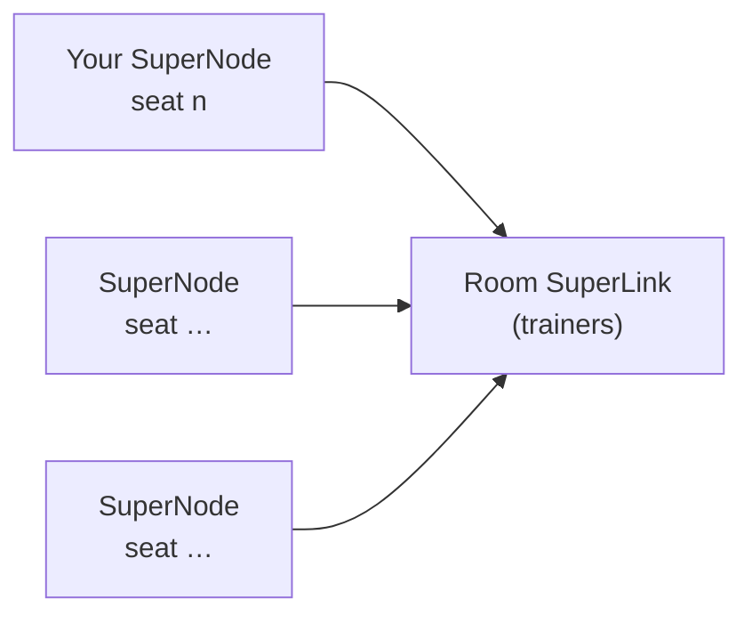

---
hide:
  - navigation
  - toc
---

# 4. Room federation

<div class="ws-meta" markdown="span">
  <span class="ws-badge">:material-flag-outline: Step 4 / 5</span>
  <span class="ws-badge">:material-clock-outline: 15 min</span>
  <span class="ws-badge">:material-account-multiple-outline: Everyone</span>
</div>

--8<-- "hands-on-stepper.md"

!!! abstract "Goal"

    The whole room trains one model together. You run one real Flower SuperNode, you
    pick your local epochs, and the server measures what your updates bring.

Phase 1 simulated five clients in your notebook. Now **you are one client**. The
trainers run one SuperLink for the room. Your SuperNode connects to it, receives the
room model each round, trains it on your share of the data and sends it back.



Two rules for this run:

- **Each round has a deadline.** An update that arrives after it does not count for
  that round.
- **The server measures your impact**: how many accuracy points the room model loses
  when it leaves your update out. It measures this on images that no client holds.
  Nothing you declare is taken into account.

## 4.1 Open the join notebook

In the file browser of the hub, open `notebooks/join.ipynb` and run its first cell.

!!! checkpoint "You should see"

    The notebook *Federated learning with Flower: phase 2, the room federation*. The
    first cell, `from flworkshop import room`, runs without output.

## 4.2 Pick your local epochs and join

Pick 1, 2, 5 or 10 local epochs: it is the only number you change. Think back to
step 2: everyone waited for the slowest client. Here nobody waits: a late update is
dropped.

```python
room.join(epochs=2)
```

Your seat comes from your hub user name (`user07` is seat 7). It decides your share
of the data.

!!! checkpoint "You should see"

    ```text
    Seat 7, 2 local epoch(s), SuperLink 127.0.0.1:9092
    Running: flower-supernode --insecure --superlink 127.0.0.1:9092 --port 9107 --node-config "seat=7 local-epochs=2"
    ```

    The second line is the Flower command now running in the background. The same
    line starts a SuperNode from a terminal.

Then check it:

```python
room.status()
```

!!! checkpoint "You should see"

    `SuperNode running (pid …), connected`. Once the trainers start the run, the
    rounds received and the updates sent go up each time you re-run the cell.

## 4.3 Watch the room run

The projector shows the **Room** tab of the trainers' dashboard: the room model, and
one row per seat with its rounds (green: on time, amber: late, red: disconnected), its
presence and its impact.

!!! checkpoint "You should see"

    Your seat on the leaderboard after the first round or two. A seat that is always
    late stays at an impact of 0.

## 4.4 Stop and rejoin

When the trainers ask, half the room stops its SuperNode:

```python
room.leave()
```

Watch the projector: the rounds go on with fewer seats. When the trainers say so,
rejoin. You may change your local epochs:

```python
room.join(epochs=2)
```

!!! checkpoint "You should see"

    After `room.leave()`: `SuperNode stopped`. On the projector, your seat is marked
    disconnected for one round, then stays empty until you rejoin.

## Discuss

1. Which local epochs did the seats at the top pick? Is it the choice your step 3
   results suggested?
2. A seat that is always late brings nothing. Why does the server drop late updates
   instead of waiting, as in step 2?
3. Some impacts are negative. What can make one client's update hurt the average?

## Done?

<div class="ws-checklist" markdown>

- [ ] My SuperNode took part in the room run
- [ ] I found my seat on the leaderboard
- [ ] I stopped and rejoined when asked

</div>

??? question "Stuck?"

    - **`No seat number in your user name`**: pass the seat the trainers gave you,
      `room.join(epochs=2, seat=7)`.
    - **`room.status()` says `connecting to the SuperLink...` for more than a minute**:
      the room SuperLink is not up yet. Tell a trainer.
    - **`Your SuperNode hit an error`**: read the lines it prints, then call a trainer.
    - **`already running`**: run `room.leave()`, then `room.join(...)` again.

??? tip "Going further: join from your laptop"

    Your laptop can take your seat instead of the hub. It needs the repository, the
    data (see [Setup](../setup.md)) and an outbound connection to port 9092 of the hub.
    Stop your hub SuperNode first (`room.leave()`), so that your seat is not used
    twice. From the repository root, with the hub address given by the trainers:

    === "Linux / macOS"

        ```bash
        uv sync
        uv run flower-supernode --insecure --superlink <vm-host>:9092 --port 9107 --node-config "seat=7 local-epochs=2"
        ```

    === "Windows PowerShell"

        ```powershell
        uv sync
        uv run flower-supernode --insecure --superlink <vm-host>:9092 --port 9107 --node-config "seat=7 local-epochs=2"
        ```

    Replace `7` with your seat in both places. Stop it with ++ctrl+c++.

[:octicons-arrow-right-24: Step 5: Debrief](05-debrief.md){ .md-button .md-button--primary }
