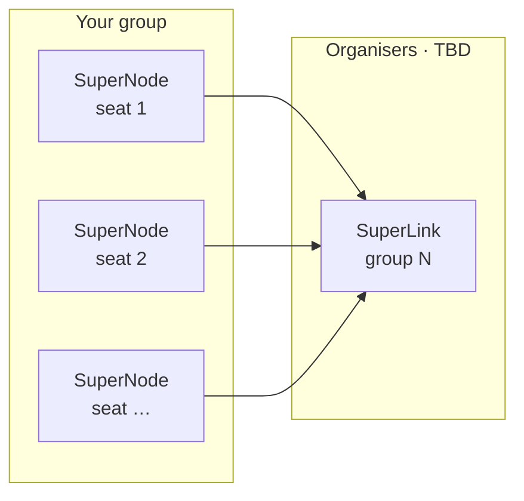

---
hide:
  - toc
  - navigation
---

# Hands-on

  :material-clock-outline: 60 min
  :material-account-group-outline: Groups of 4–5
  :material-flower-outline: Flower

--8<-- "hands-on-stepper.md"

You build a small federation, then put it under stress: unequal data, slow clients,
costly communication, failures. Six short steps; each one asks a question, you predict
the answer, launch one run and check it in the dashboard.

!!! info "Two ways to run, one path"

    **Deployed** (main): one SuperLink per group, each member runs one SuperNode, the
    group lead launches the runs. **Simulation** (fallback, if the trainers ask your group
    to switch): each member simulates the five clients in one notebook.
    Only [step 0](00-setup.md) differs; steps 1 to 5 are the same for both.

## Your group { #your-group }

<!-- Groups and SuperLink addresses: docs/assets/javascripts/groups.js -->
Pick your group and seat. The commands on the next pages will use your values.

  
Loading… (requires JavaScript)

## Architecture

<!-- TODO: final topology (hosts, ports) -->

## Steps

-   :material-numeric-0-circle-outline:{ .lg } **Setup**

    ---

    Build the federation: deployed with your group, or simulated in one notebook.

    :material-clock-outline: 10 min
    :material-account-group-outline: Group

    [:octicons-arrow-right-24: Start](00-setup.md)

-   :material-numeric-1-circle-outline:{ .lg } **First run**

    ---

    Each client holds two classes. Alone or together, what can a model recognise? What travels on the network?

    :material-clock-outline: 12 min
    :material-account-group-outline: Group

    [:octicons-arrow-right-24: Start](01-first-run.md)

-   :material-numeric-2-circle-outline:{ .lg } **Heterogeneity**

    ---

    Unequal data, unequal clients: what happens to accuracy and to the round time?

    :material-clock-outline: 12 min
    :material-account-group-outline: Group

    [:octicons-arrow-right-24: Start](02-heterogeneity.md)

-   :material-numeric-3-circle-outline:{ .lg } **Compute vs communication**

    ---

    Same compute budget, fewer or more rounds: when does talking less pay off?

    :material-clock-outline: 12 min
    :material-account-group-outline: Group

    [:octicons-arrow-right-24: Start](03-compute-vs-communication.md)

-   :material-numeric-4-circle-outline:{ .lg } **Failures**

    ---

    Clients that are not sampled or drop out mid-round: does the federation survive?

    :material-clock-outline: 9 min
    :material-account-group-outline: Group

    [:octicons-arrow-right-24: Start](04-failures.md)

-   :material-numeric-5-circle-outline:{ .lg } **Debrief**

    ---

    Compare the groups and connect with the cross-centre demo.

    :material-clock-outline: 5 min
    :material-account-multiple-outline: Everyone

    [:octicons-arrow-right-24: Start](05-debrief.md)

## How these pages work

!!! checkpoint "You should see"

    Expected output after a command. Compare before moving on.

!!! question "Stuck?"

    Collapsed boxes with common issues. Open them before calling a trainer.

!!! tip "Going further"

    Optional extras for groups that finish early.

!!! success "Done?"

    Tick the boxes at the end of each step. The bar at the top marks the step as done.

## Run-config reference { #run-config }

Each step changes only the `--run-config` string. These are all the keys:

| Key | Values | Default | Used in |
|---|---|---|---|
| `partitioning` | `iid`, `dirichlet`, `pathological` | `iid` | [Step 1](01-first-run.md), [Step 2](02-heterogeneity.md) |
| `dirichlet-alpha` | > 0; smaller = more uneven | `0.1` | [Step 2](02-heterogeneity.md) |
| `classes-per-partition` | Classes per client for `pathological` | `2` | [Step 1](01-first-run.md) |
| `num-server-rounds` | Number of rounds | `10` | [Step 3](03-compute-vs-communication.md) |
| `local-epochs` | Local epochs per round | `2` | [Step 3](03-compute-vs-communication.md) |
| `fraction-train` | Share of clients sampled per round, 0 to 1 | `1.0` | [Step 4](04-failures.md) |
| `dropout-rate` | Probability that a sampled client fails, 0 to 1 | `0.0` | [Step 4](04-failures.md) |
| `proximal-mu` | ≥ 0; > 0 turns on FedProx | `0.0` | [Step 5, going further](05-debrief.md) |
| `dataset` | `fashion_mnist`, `cifar10` | `fashion_mnist` | [Step 5, going further](05-debrief.md) |

Keep `learning-rate` (0.01), `batch-size` (32) and `seed` (42) as they are: the expected
results assume these values. What the keys mean: [Concepts](../concepts.md).

[:octicons-arrow-right-24: Start with step 0](00-setup.md){ .md-button .md-button--primary }
