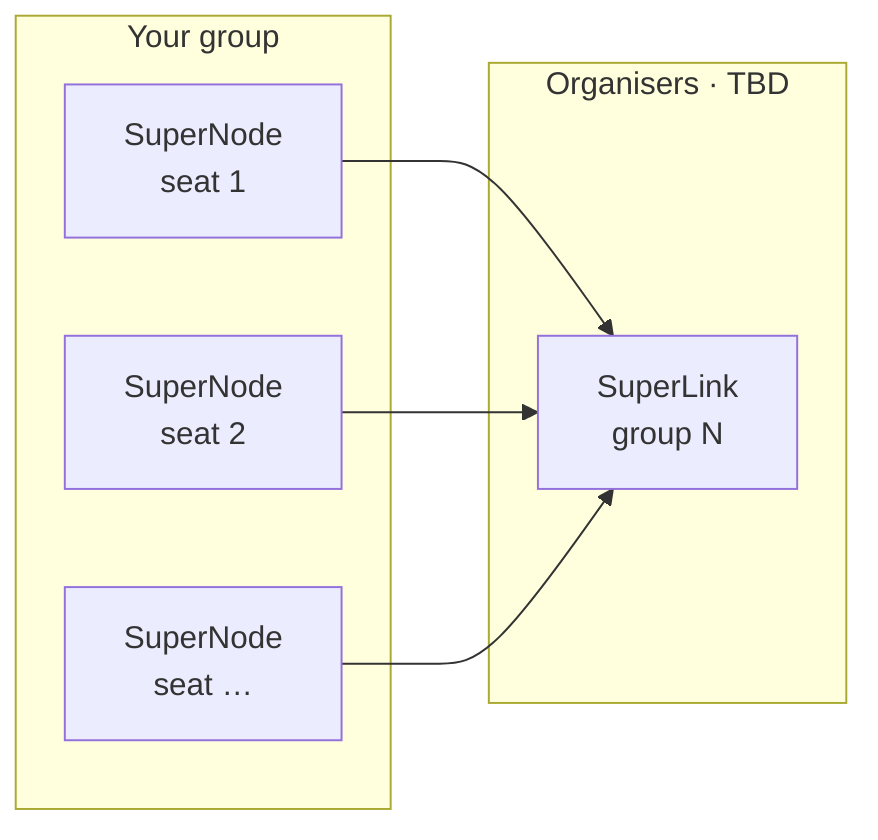

---
hide:
  - toc
  - navigation
---

# Hands-on

  :material-clock-outline: 60 min
  :material-account-group-outline: Groups of 4–5
  :material-flower-outline: Flower

--8<-- "hands-on-stepper.md"

<!-- TODO: goal of the hands-on, in one or two sentences -->
TBD

## Your group { #your-group }

<!-- Groups and SuperLink addresses: docs/assets/javascripts/groups.js -->
Pick your group and seat. The commands on the next pages will use your values.

  
Loading… (requires JavaScript)

## Architecture

<!-- TODO: final topology (hosts, ports) -->

## Steps

-   :material-numeric-1-circle-outline:{ .lg } **Local simulation**

    ---

    <!-- TODO: short description -->
    TBD

    :material-clock-outline: TBD
    :material-account-outline: Solo

    [:octicons-arrow-right-24: Start](01-simulation.md)

-   :material-numeric-2-circle-outline:{ .lg } **Group deployment**

    ---

    <!-- TODO: short description -->
    TBD

    :material-clock-outline: TBD
    :material-account-group-outline: Group

    [:octicons-arrow-right-24: Start](02-deployment.md)

-   :material-numeric-3-circle-outline:{ .lg } **Experiments**

    ---

    <!-- TODO: short description -->
    TBD

    :material-clock-outline: TBD
    :material-account-group-outline: Group

    [:octicons-arrow-right-24: Start](03-experiments.md)

-   :material-numeric-4-circle-outline:{ .lg } **Debrief**

    ---

    <!-- TODO: short description -->
    TBD

    :material-clock-outline: TBD
    :material-account-multiple-outline: Everyone

    [:octicons-arrow-right-24: Start](04-debrief.md)

## How these pages work

!!! checkpoint "You should see"

    Expected output after a command. Compare before moving on.

!!! question "Stuck?"

    Collapsed boxes with common issues. Open them before calling a trainer.

!!! tip "Going further"

    Optional extras for groups that finish early.

!!! success "Done?"

    Tick the boxes at the end of each step. The bar at the top marks the step as done.

[:octicons-arrow-right-24: Start with step 1](01-simulation.md){ .md-button .md-button--primary }
