---
hide:
  - navigation
  - toc
---

{ .ws-hero__logo }

Workshop

# Federated Learning with Flower & NVIDIA FLARE

<!-- TODO: one-sentence pitch of the workshop -->
Train a model across several machines without moving the data.

[Get ready :material-arrow-right:](setup.md){ .md-button .md-button--primary }
[Go to the hands-on](hands-on/index.md){ .md-button }

## Agenda

-   :material-school-outline:{ .lg } **Concepts**

    ---

    <!-- TODO: short description -->
    TBD

    [:octicons-arrow-right-24: Concepts](concepts.md)

-   :material-play-circle-outline:{ .lg } **Demo**

    ---

    <!-- TODO: short description -->
    TBD

    [:octicons-arrow-right-24: Demo](demo.md)

-   :material-coffee-outline:{ .lg } **Break**

    ---

    TBD

-   :material-laptop:{ .lg } **Hands-on**

    ---

    <!-- TODO: short description -->
    TBD

    [:octicons-arrow-right-24: Hands-on](hands-on/index.md)

## Before the workshop

!!! warning "Setup required"

    <!-- TODO: what participants must do before coming -->
    Complete the [Setup](setup.md) page before the session.

## Organisers

<!-- TODO: names, contacts -->
TBD
